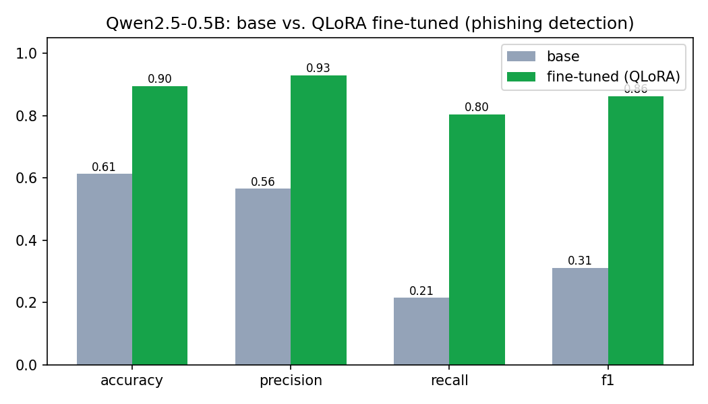

# Phishing Detection with QLoRA

Fine-tuning a small open-weight LLM to flag **phishing** messages, using **4-bit QLoRA** on a single consumer GPU, and measuring whether the fine-tune actually helped.

The question this project answers is not "can an LLM detect phishing" but "**does fine-tuning a small model measurably beat the base model**, and by how much, on a held-out test set." The whole pipeline (data preparation, supervised fine-tuning, and evaluation) is in one reproducible notebook.

## What it does

- Takes **Qwen2.5-0.5B-Instruct** (an open-weight, ungated model) and adapts it to classify a message as `phishing` or `legitimate`.
- Fine-tunes with **QLoRA**: the base model is loaded in 4-bit (NF4), and only small **LoRA** adapters are trained, so the whole run fits on a free Colab T4.
- Evaluates the **base model and the fine-tuned model on the same held-out test set**, and reports accuracy, precision, recall, and F1 so the improvement is measured, not assumed.

## Results

Qwen2.5-0.5B-Instruct, QLoRA (r=16), 1 epoch. Trained on 3,400 messages, evaluated on a held-out test set of 400 messages.

| Metric | Base model | Fine-tuned (QLoRA) | Δ |
|---|---|---|---|
| Accuracy | 0.613 | 0.895 | +0.282 |
| Precision | 0.565 | 0.929 | +0.365 |
| Recall | 0.215 | 0.804 | +0.589 |
| F1 | 0.311 | 0.862 | +0.551 |

_Short read of the results: the biggest change is recall. The base model is a weak detector, it only catches about 21% of phishing messages, so despite middling precision its F1 is just 0.31. After QLoRA fine-tuning the model catches 80% of phishing (recall 0.804) while precision climbs to 0.929, nearly tripling F1 to 0.862 and lifting accuracy from 61% to 90%. Fine-tuning a 0.5B model on this task measurably and substantially beats the base model._

## Approach

**Task framing.** Classification is cast as instruction following: a system prompt tells the model to answer with a single word, the message is the user turn, and the label is the assistant turn. At inference the model generates its answer, which is parsed back to a label. This keeps the model a general text model rather than adding a classification head, which is closer to how these models are used in practice.

**Fine-tuning.** 4-bit NF4 quantization with double quantization (QLoRA), LoRA adapters on the attention and MLP projections (`q,k,v,o,gate,up,down`), a paged 8-bit optimizer, and fp16 compute (the T4 does not support bf16). Only the adapters are trained.

**Evaluation.** The same held-out test set is scored before and after fine-tuning with identical prompting and greedy decoding, so the only thing that changes is the weights. Metrics are computed with scikit-learn, and a confusion matrix is printed for each model.

## Run it

Open the notebook in Google Colab, set **Runtime > Change runtime type > T4 GPU**, and **Run all**. End to end it takes roughly 15-25 minutes. Keep the browser tab in the foreground so the free runtime does not disconnect for being idle.

- Notebook: [`notebooks/phishing_qlora.ipynb`](notebooks/phishing_qlora.ipynb)

Dependencies are pinned in [`requirements.txt`](requirements.txt).

## Dataset

A public phishing-email dataset (`zefang-liu/phishing-email-dataset`). The notebook auto-detects the text and label columns, maps labels to a binary target, drops empty rows, and makes a stratified train/test split. Swapping in another text-classification dataset is a one-line change.

## Honest notes and limitations

- **Small model, small run.** This is a 0.5B model fine-tuned for a short time to keep the project reproducible on free hardware. It is a demonstration of the full QLoRA workflow and its measured effect, not a production detector.
- **Full-sequence SFT.** Training computes loss over the whole rendered sequence rather than masking the prompt and training only on the completion. For a one-word label this works well; completion-only loss masking is the natural next refinement.
- **One dataset.** Results reflect one dataset's distribution. A fairer picture would evaluate across multiple phishing sources.

## Stack

PyTorch · Hugging Face Transformers, Datasets · PEFT (LoRA) · bitsandbytes (4-bit QLoRA) · scikit-learn · Google Colab (T4)
